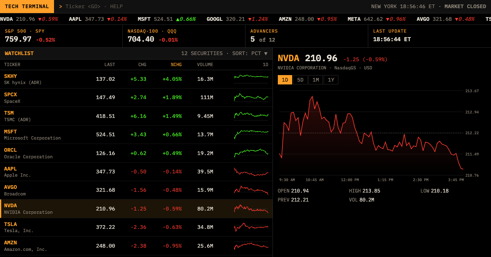

# Tech Terminal

Big tech stocks on a trading-terminal board: amber on black, a ticker tape, a command line, function keys, sparklines and 1D / 5D / 1M / 1Y charts. Inspired by trading terminals; not affiliated with any.

**Live:** https://tech-stock-tracker.vercel.app



Default watchlist: NVDA, AAPL, MSFT, GOOGL, AMZN, META, AVGO, TSM (TSMC ADR), SKHY (SK hynix ADR), TSLA, SPCX (SpaceX), ORCL, plus SPY and QQQ for the S&P 500 and Nasdaq-100. Add or remove tickers from the command line; your list is saved in your browser.

## Where the data comes from

- **Without a key:** quotes, charts and volume come from Yahoo Finance's chart data, through a small Vercel function (`api/yahoo.mjs`) that caches responses at the edge (60 s for quotes, up to an hour for daily charts). It's an unofficial source and can change or be rate-limited without notice.
- **With your own Finnhub key:** press **F6** (or type `KEY`) and paste a free key from [finnhub.io](https://finnhub.io/register). Quotes and market caps then come from Finnhub, called straight from your browser. The key is kept only in that tab's memory: it isn't saved (no localStorage, cookies or server), isn't sent to this site, and is forgotten when you reload. Charts and volume still come from Yahoo, because Finnhub's free plan has no price history; non-US listings (like `000660.KS`) always do.

Not investment advice.

## Commands

| Type | Does |
|---|---|
| `AAPL` ⏎ or `AAPL <GO>` | Show a ticker; add it to the watchlist if it's new (`HYNIX`, `SPACEX`, `TSMC` work too) |
| `DEL AAPL` | Remove it |
| `1D` `5D` `1M` `1Y` | Chart range |
| `SORT PCT` | Sort by `PCT`, `CHG`, `LAST`, `VOL`, `MCAP` (with a key) or `SYM` |
| `KEY` · `HELP` · `RESET` | Finnhub key · help · default watchlist |

Keys: **F1** help · **F2** sort · **F3** range · **F4** add · **F5** refresh · **F6** Finnhub key · **/** command line · **↑ ↓** move through the list. On phones the function keys are buttons along the bottom.

## Develop

No dependencies; Node 20+.

```sh
npm run dev                 # http://localhost:3000 (serves public/ and /api/yahoo)
npm i --no-save puppeteer-core@23.11.1
npm run brand               # favicon set + share image (screenshot of the running app; needs Chrome)
```

```
public/        the page: index.html, app.js, style.css, fonts, icons
api/yahoo.mjs  Vercel function → lib/yahoo.mjs (Yahoo chart data, validated and cached)
scripts/       local dev server and the brand script
```

Vercel serves `public/` as static files and `api/` as functions (`vercel.json`), with Vercel Web Analytics.

## License

MIT. Fonts: IBM Plex Mono (SIL Open Font License).
